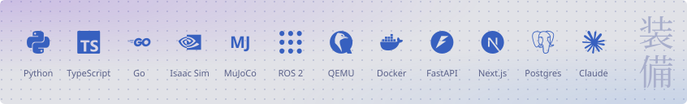
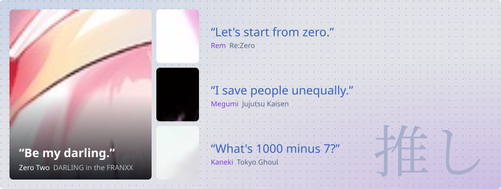

<picture><source media="(prefers-color-scheme: dark)" srcset="https://raw.githubusercontent.com/qsang793/qsang793/output/clock-dark.svg"></picture>

### Sang Nguyen

Software engineer. I build agents and developer tools. By day, I simulate humanoid robots.

<picture><source media="(prefers-color-scheme: dark)" srcset="https://raw.githubusercontent.com/qsang793/qsang793/output/intro-dark.svg"></picture>

### Stack

<picture><source media="(prefers-color-scheme: dark)" srcset="https://raw.githubusercontent.com/qsang793/qsang793/output/stack-dark.svg"></picture>

### Activity

<picture><source media="(prefers-color-scheme: dark)" srcset="https://raw.githubusercontent.com/qsang793/qsang793/output/city-dark.svg"></picture>

Subaru: model by <a href="https://hub.vroid.com/en/characters/2527299861430843430/models/3392138998639283709">Madoka-Senpai</a> (VRoid Hub)

### Off the clock

<picture><source media="(prefers-color-scheme: dark)" srcset="https://raw.githubusercontent.com/qsang793/qsang793/output/anime-dark.svg"></picture>
